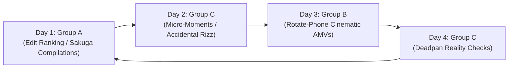
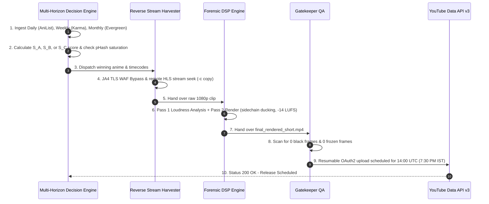

# Autonomous Channel Production Architecture (Zero-Touch Specification)
**Channel:** [@animefandom0_0](https://www.youtube.com/@animefandom0_0)  
**Standard:** 100% Autonomous, Zero-Human-Touch Daily Publishing Engine  
**Publishing Window:** Every day at **7:30 PM IST (14:00 UTC)**  

---

## 1. 3-Group Harmonized Publishing Rotation

To maximize YouTube Shorts algorithmic reach, prevent audience fatigue, and trigger different viewer behaviors (comments vs. replays vs. shares), the channel cycles through **3 complementary content archetypes**:



| Group | Content Archetype | Format & Staging | Audio Standard | Algorithmic Driver |
| :--- | :--- | :--- | :--- | :--- |
| **Group A** | **Single-Franchise Viral Rankings** (Top 5 Coldest Auras, Climax Sakuga) | 1080×1920 (9:16), dynamic blur / 4K native, countdown HUD | Phonk / High-octane battle beat drops, bass risers | **High Comment Friction & Shares** (*"Who had #1?"*) |
| **Group B** | **Rotate-Phone Cinematic AMV** (0° to -90° IMAX Action) | Animated phone-tilt hook (0–2s), counter-clockwise rotation into fullscreen landscape | Spatial foley, massive sub-bass drops, zero intrusive SFX | **High Watch-Time & Interaction** (*Viewer tilts device*) |
| **Group C** | **Micro-Moments & Accidental Rizz** (Jinshi, Dandadan, Frieren) | 1080×608 uncropped 16:9 at `y=656`, flush header at `y=456`, parallax wallpaper | Warm lofi bed, -15 dB sidechain ducking, deadpan mute | **High APV (>95%) & Second Loops** (*Relatable comedy*) |

---

## 2. The 5-Stage Zero-Touch Pipeline

Every day at **02:00 UTC (7:30 AM IST)**, the automated daemon wakes up and executes the following sequence:



---

## 3. Automation Setup: Windows Task Scheduler

To run this pipeline without manual intervention, configure a scheduled task in Windows:

### Step 1: Create the Execution Batch Script (`run_daily_autonomous.bat`)
```bat
@echo off
cd /d "C:\Users\saumy\OneDrive\Desktop\anime compiation"
"C:\Users\saumy\AppData\Local\Programs\Python\Python311\python.exe" scripts\engine\autonomous_channel_manager.py >> logs\autonomous_daily.log 2>&1
```

### Step 2: Register in Windows Task Scheduler (PowerShell One-Liner)
```powershell
$Action = New-ScheduledTaskAction -Execute "C:\Users\saumy\OneDrive\Desktop\anime compiation\run_daily_autonomous.bat"
$Trigger = New-ScheduledTaskTrigger -Daily -At 7:30AM
Register-ScheduledTask -TaskName "AnimeFandom_Autonomous_Shorts" -Action $Action -Trigger $Trigger -Description "Daily autonomous anime shorts producer for @animefandom0_0"
```

---

## 4. Self-Healing & Failure Safeguards
1. **WAF Fallback:** If Cloudflare triggers a CAPTCHA challenge on the primary HLS provider, the harvester automatically routes through `yt-dlp` direct micro-clipping (`--download-sections`).
2. **QA Re-Render:** If `blackdetect` fails (>0.2s black frame), the engine discards the file, shifts the start timecode by +1.0 second, and re-renders.
3. **OAuth Token Renewal:** Refresh tokens are automatically exchanged for fresh access tokens before every upload (`scripts/engine/qa_scheduler.py`), preventing authentication failures.
