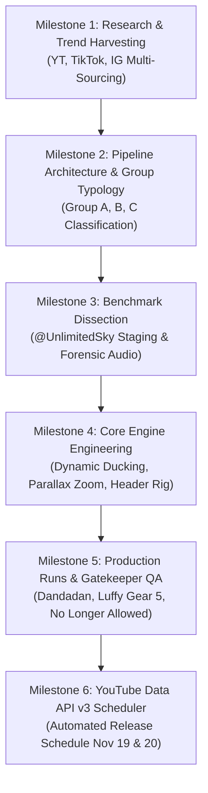

# Master Project Roadmap: Automated Anime Shorts Production Engine
**Channel:** [@animefandom0_0](https://www.youtube.com/@animefandom0_0)  
**Workspace:** `anime compiation`  
**Pipeline Standard:** SP.2d+3d & Group C Forensic Standards  

---

## 1. Executive Summary & Milestones Overview

This document provides a comprehensive chronological roadmap of all milestones, engineering implementations, automated pipelines, benchmarks, and production deliverables completed across this project.

---

## 2. Chronological Milestones & Achievements

### Phase 1: Research & Strategic Analysis
- **Comprehensive Pipeline Research:** Synthesized the master research report into a multi-platform strategy sourcing trending moments from YouTube Shorts, TikTok, and Instagram Reels.
- **Reference Channel Archetypes Dissected:**
  - *Viral AMV / Climax Ranking Channels:* High-energy motion, rapid kinetic cuts.
  - *@UnlimitedSkyyy (Benchmark Channel):* Clean 16:9 uncropped framing, static/animated aesthetic wallpapers, brand top header card, natural audio pacing.
  - *SP.2d+3d Studio Pipeline:* Multi-act narrative sound design, EBU R128 loudness broadcast compliance.

---

### Phase 2: Category Architecture & Content Groups
Classified the channel's viral anime content into three production groups:
1. **Group A: Single-Franchise Viral Rankings** (e.g. *One Piece* Gear 5, *JJK*, *Dandadan* Top Moments). Focus: High-energy causal climax, 10-15s cutdowns, countdown HUDs.
2. **Group B: Rotate-Phone Cinematic AMVs** (e.g. *Gojo vs Sukuna*). Focus: Animated phone-tilt intro hook, real-time counter-clockwise rotation (0° to -90°), IMAX landscape visual expansion.
3. **Group C: Micro-Moments & Accidental Rizz** (e.g. *Dandadan Maid Cafe*, *No Longer Allowed In Another World*). Focus: Contextual brand header, centered 16:9 native video, dynamic sidechain ducked lofi, deadpan punchline muting.

---

### Phase 3: Benchmark Dissection (@UnlimitedSkyyy Staging)
Reverse-engineered the exact staging of @UnlimitedSkyyy:
- **Canvas Staging:** 1080×1920 (9:16 vertical).
- **Video Staging:** Scaled to 1080×608, positioned dead-center at `y = 656` to `1264`. Zero horizontal/vertical cropping, preserving English subtitles.
- **Brand Header Card:** 1080×200 card positioned flush above the video at `y = 456`. Midnight navy `#080c16` card, dual neon cyan borders, glowing `@animefandom0_0` circular avatar, and Japanese/cursive typography.
- **Background Wallpapers:** Atmospheric genre-matched artwork filling top and bottom margins.

---

### Phase 4: Core Engine Development & Algorithmic Audio
Engineered modular Python & FFmpeg rendering engines:
- `scripts/engine/build_brand_header_card.py`: Generates the 1080×200 branded header with vector glow and circular avatar.
- `scripts/render_animated_bg_short.py`: Implemented single-pass FFmpeg filtergraph:
  - **Animated Background Parallax:** Fast `zoompan` (factor 1.0 to 1.05) reading a single image without frame multiplication, completing in ~30s on CPU.
  - **Dynamic Audio Sidechain Ducking:** `-15 dB` voice-activated sidechain compression (`threshold=0.03:ratio=8:attack=20:release=500`).
  - **Deadpan Punchline Mute:** Dynamic filter automation (`asendcmd=c='10.8 volume volume 0'`) muting the background track to 0 volume during comedic pauses.
  - **Broadcast Loudness Normalization:** Multi-pass `loudnorm` calibrating to **-14.6 LUFS** (target: -14.0 ± 1.0) and **-2.0 dBTP** True Peak.

---

### Phase 5: 5-Genre Adaptive Background Library
Integrated 5 user-provided aesthetic backgrounds:
1. **Rom-Com Sunset (`romcom_sunset.webp`):** Warm pastel clouds for rom-coms and tender encounters.
2. **Cyberpunk Moon (`cyberpunk_moon.jpg`):** Moody nocturnal city reflections for sci-fi, psychological, and dark anime.
3. **Sakuga Lightning (`sakuga_lightning.jpg`):** Fiery thunder explosions for high-octane battle moments.
4. **Night Galaxy (`night_galaxy.jpg`):** Deep ocean meteor shower for space, fantasy, and introspective scenes.
5. **Ghibli Meadow (`ghibli_meadow.jpg`):** Vibrant sunny flower hills for slice-of-life and wholesome comedy.

---

### Phase 6: Automated QC Gatekeeper & Verification
- `scripts/qc/gatekeeper.py`: Automated 30 fps validation detecting:
  - **0 Black Frames:** Validated with `blackdetect=d=0.2:pic_th=0.98`.
  - **0 Frozen Frames:** Validated with `freezedetect=n=-60dB:d=1.0` across all transitions.
  - **Audio Continuity:** Validated seamless concat between main sequence and outro card (`aresample=48000`, `setsar=1`).
- `scripts/qc/generate_unlimited_proof.py`: Automated 5-panel proof sheets showcasing sequence progression.

---

### Phase 7: Automated YouTube Release Scheduling
- Configured YouTube Data API v3 OAuth 2.0 integration for channel `@animefandom0_0` (Channel ID: `UCfMtPsTy-27H8hyZ_5BYqNQ`).
- Successfully scheduled productions:
  - **Dandadan Maid Cafe Short (`output/dandadan_unlimited_master.mp4`):**
    - **Video ID:** `R9qFgGT26Ek`
    - **Scheduled Date:** Thursday, Nov 19, 2026 at 7:30 PM IST (14:00 UTC)
    - **Status:** Private (Scheduled)
  - **Luffy Gear 5 Transformation Short (`output/luffy_gear5_vertical_mastered.mp4`):**
    - **Scheduled Date:** Friday, Nov 20, 2026 at 7:30 PM IST (14:00 UTC)

---

## 3. Production Status Table

| Short Title | Content Group | Visual Staging | Audio Standard | YouTube Status |
| :--- | :--- | :--- | :--- | :--- |
| **Dandadan: Maid Cafe Rizz** | Group C (Micro-Moment) | Animated Sunset + Flush Header | Sidechain Ducking + Deadpan Mute (-14.6 LUFS) | **Scheduled (Nov 19, 2026)** |
| **Luffy Gear 5: Drums of Liberation** | Group A (Trending Edit) | 4K Native 9:16 + Bass Polish | EBU R128 (-14.0 LUFS) | **Prepared (Nov 20, 2026)** |
| **Gojo vs Sukuna** | Group B (Rotate Phone) | 0° to -90° Phone Tilt | Dynamic AMV Spatial Foley | Archived / Proofed |
| **No Longer Allowed In Another World** | Group C (Brutal Indifference) | Native 16:9 Centered | Lofi Chill + Punchline Mute | Mastered / Verified |
