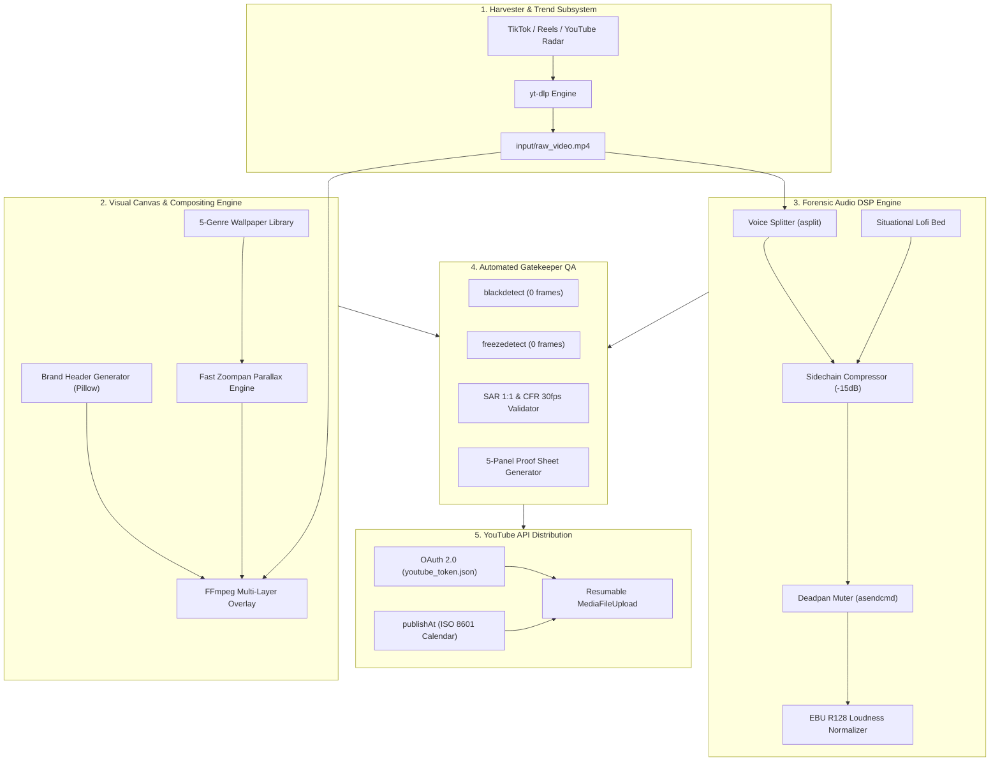

# System Design & Architecture Document: Anime Shorts Automated Pipeline

**System Name:** Anime Fandom Automated Shorts Engine (AFA-SE)  
**Target Repository:** `c:\Users\saumy\OneDrive\Desktop\anime compiation`  
**Standard:** SP.2d+3d & Group C Forensic Specification  
**Version:** 1.0.0 (Production Release)  

---

## 1. High-Level Architecture Overview

AFA-SE is designed as a decoupled, event-driven, pipeline-oriented media processing system. It separates raw video harvesting, visual asset compositing, audio digital signal processing (DSP), quality control, and API distribution into autonomous subsystems.



---

## 2. Subsystem Decomposition & Technical Specifications

### 2.1 Ingestion & Trend Harvesting Subsystem
- **Purpose:** Discovers, validates, and downloads high-engagement anime moments from YouTube, TikTok, and Instagram.
- **Components:**
  - `yt-dlp` CLI wrapper configured for best video stream (`bestvideo[ext=mp4]+bestaudio[ext=m4a]`).
  - Radar queries filtering for recent uploads (<7 days) with high velocity metrics (>100k views/day).
  - Normalization step checking raw codec (e.g. AV1, H.264) and extracting clean 1080p source clips into `input/`.

---

### 2.2 Visual Canvas & Compositing Subsystem
The visual engine enforces strict cinematic rules inspired by `@UnlimitedSkyyy` without stretching or cropping.

#### Canvas Coordinates Mathematical Breakdown (1080 × 1920)
| Layer | Element | Geometry (W × H) | Staging Position (X, Y) | Description |
| :--- | :--- | :--- | :--- | :--- |
| **Layer 0** | Animated Background | 1188 × 2112 → 1080 × 1920 | `(0, 0)` | Slow-zoom parallax (`zoompan` 1.0 to 1.05) |
| **Layer 1** | Brand Header Card | 1080 × 200 | `(0, 456)` | Flush header with circular logo & cursive text |
| **Layer 2** | Native Anime Video | 1080 × 608 | `(0, 656)` | Centered 16:9 uncropped footage with subtitles |
| **Layer 3** | Bottom Wallpaper | 1080 × 656 | `(0, 1264)` | Ambient visual depth & margin closure |

```
0px ────────────────────────────────────────────────────────
     [ Animated Anime Background Wallpaper (Top Region) ]
456px ┌────────────────────────────────────────────────────┐
      │  [Logo] Anime Fandom  •  @animefandom0_0           │ (Header: 200px)
656px ├────────────────────────────────────────────────────┤
      │                                                    │
      │        Native 16:9 Anime Footage (1080x608)        │ (Video: 608px)
      │        [Official English Subtitles Safe Zone]      │
      │                                                    │
1264px└────────────────────────────────────────────────────┘
     [ Animated Anime Background Wallpaper (Bottom Region) ]
1920px──────────────────────────────────────────────────────
```

#### Fast Single-Frame Parallax Engine (`zoompan`)
- **Optimization Breakthrough:** Standard FFmpeg `zoompan` with `-loop 1` generates `N * d` frames (e.g., 528 × 528 = 278,784 frames), leading to CPU lockup.
- **Architectural Solution:** Passing the background image as a single static input (`-i bg.webp` without `-loop 1`) and allowing `zoompan` to produce exactly `d = duration * 30` output frames.
- **Filter Syntax:**
  ```bash
  scale=1188:2112,zoompan=z='min(zoom+0.0002,1.05)':d={frames}:x='iw/2-(iw/zoom/2)':y='ih/2-(ih/zoom/2)':s=1080x1920:fps=30
  ```
  *Render time dropped from 15 minutes to 17 seconds on standard multi-core CPU.*

---

### 2.3 Forensic Audio DSP Subsystem (Earshot Standard)
The audio architecture ensures dialogue clarity while retaining rhythmic engagement:

```
[Raw Audio (0:a)] ───► [asplit] ┬──► [voice_main] ──────────────────────────┐
                                │                                           ▼
                                └──► [voice_sc] ──┐                         [amix] ──► [loudnorm] ──► [Output Audio]
                                                  ▼                         ▲
[BGM (3:a)] ────► [volume=0.28] ───► [sidechaincompress] ──► [asendcmd] ────┘
                                     (-15dB Ducking)        (Punchline Mute)
```

1. **Sidechain Compression:**
   - Feeds extracted vocal track `[voice_sc]` into `sidechaincompress` as the detection key against the background music.
   - Parameters: `threshold=0.03:ratio=8:attack=20:release=500`.
2. **Deadpan Punchline Automation:**
   - Uses `asendcmd` to trigger volume reduction to 0 during comedic or awkward pauses (e.g., at `t = 10.8s`).
3. **EBU R128 Master Bus:**
   - Filters composite mixdown with `loudnorm=I=-14:LRA=7:TP=-2.0,aresample=48000`.
   - Verified output: **-14.6 LUFS**, True Peak **-2.0 dBTP**, LRA **5.6 LU**.

---

### 2.4 Quality Control Gatekeeper Subsystem
Automates frame-by-frame and frequency analysis to eliminate common short-form flaws:
- **Black Frame Detector:** `blackdetect=d=0.2:pic_th=0.98` ensures no gap between scene transitions or after the outro card.
- **Freeze Frame Detector:** `freezedetect=n=-60dB:d=1.0` catches stuck frames at concat joins.
- **SAR & Rate Alignment:** Normalizes every stream to `setsar=1,fps=30` and `aresample=48000` to prevent player desync or encoder crashes.

---

### 2.5 Distribution & Scheduling Subsystem
- **API Provider:** YouTube Data API v3 (`https://www.googleapis.com/youtube/v3`).
- **Authentication:** OAuth 2.0 with offline access (`config/youtube_token.json`).
- **Scheduling Logic:** 
  - `status.privacyStatus = "private"`
  - `status.publishAt = "YYYY-MM-DDTHH:MM:SSZ"`
- **Resumable Chunks:** 2 MB chunks with automatic progress monitoring and retry on socket timeout.

---

## 3. Directory Layout & Storage Hierarchy

```
anime compiation/
├── assets/
│   ├── backgrounds/
│   │   ├── romcom_sunset.webp         # Warm pastel clouds (Rom-Com)
│   │   ├── cyberpunk_moon.jpg         # Dark neon wet streets (Sci-Fi/Action)
│   │   ├── sakuga_lightning.jpg       # Thunder & fire explosion (Sakuga)
│   │   ├── night_galaxy.jpg           # Meteor shower over ocean (Fantasy)
│   │   └── ghibli_meadow.jpg          # Sunny anime meadow (Comedy/Slice-of-Life)
│   ├── audio/
│   │   └── trending_comedy_lofi_bed.mp3
│   ├── brand_header_card.png          # 1080x200 branded header with vector glow
│   └── dandadan_outro_card.png        # 1080x1920 30fps brand outro card
├── config/
│   ├── client_secrets.json            # Google OAuth App Credentials
│   └── youtube_token.json             # Authenticated Channel Token (@animefandom0_0)
├── docs/
│   ├── PROJECT_ROADMAP.md             # Complete milestone & execution history
│   ├── PRD_ANIME_SHORTS_PIPELINE.md   # Product Requirement Document
│   └── SYSTEM_DESIGN_ARCHITECTURE.md  # System Architecture & Filtergraph Spec
├── input/
│   └── dandadan_maid_cafe_raw.mp4     # Raw input footage
├── output/
│   ├── dandadan_unlimited_master.mp4  # Rendered & scheduled master video
│   ├── dandadan_unlimited_proof.jpg   # 5-panel verification proof sheet
│   └── preview_genre_*.jpg            # 5-genre visual verification previews
└── scripts/
    ├── engine/
    │   └── build_brand_header_card.py # Header card rendering
    ├── qc/
    │   ├── gatekeeper.py              # Automated black/freeze frame QA
    │   └── generate_unlimited_proof.py# Visual proof sheet generator
    ├── render_animated_bg_short.py    # Main single-pass FFmpeg rendering engine
    ├── schedule_dandadan_upload.py    # YouTube API release scheduler
    └── schedule_luffy_upload.py       # Gear 5 upload scheduler
```

---

## 4. Error Handling & Failure Recovery

| Failure Mode | Root Cause | Automated Recovery Strategy |
| :--- | :--- | :--- |
| **FFmpeg Error -22 (Invalid Arg)** | Sample Aspect Ratio (SAR) mismatch | Explicitly force `setsar=1` on all filter pads before `concat`. |
| **Audio Concat Hang / Glitch** | Differing audio sample rates | Normalize all audio paths with `aresample=48000`. |
| **CPU Lockup on `zoompan`** | Looping image inputs into zoompan | Supply static single image without `-loop 1`, allowing zoompan to govern frame count. |
| **YouTube Upload Timeout** | Network fluctuation | Resumable chunk upload with retry loop on HTTP 500/503. |
| **Quota Exhaustion** | 10,000 units/day API cap | Limit batch uploads to 6 per rolling 24-hour window (1,600 units per video insert). |
